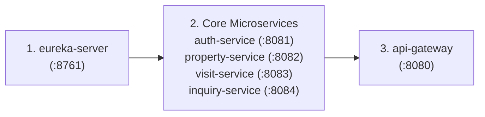

# PrimeHaven Real Estate Network
### Enterprise Real Estate Listings & Property Inspection Scheduling Platform
A Cloud-Native Spring Boot Microservices Platform for Property Catalog Management, Inquiries, and Inspection Scheduling.

---

## 📌 Project Overview
**PrimeHaven Real Estate Network** is a distributed enterprise real estate application built from scratch using **Java 21**, **Spring Boot 3.3.4**, and **Spring Cloud 2023.0.3 (Leyton)**. 

The platform separates business domains into independent microservices, providing:
1. **Stateless JWT Authentication & RBAC** (Buyers, Agents, Admins)
2. **Property Listings Catalog** with full lifecycle and search capabilities
3. **Property Inspection Visit Scheduler** for in-person home viewings
4. **Buyer Inquiry Management** with automatic inter-service inspection scheduling (`Inquiry -> Property -> Visit`)
5. **Centralized Eureka Service Discovery** and **Spring Cloud API Gateway** routing and load balancing

---

## 🏢 Services & Port Allocation

| Service Name | Port | Database | Primary Function |
| :--- | :---: | :---: | :--- |
| **`eureka-server`** | `8761` | None | Netflix Eureka Service Registry & Discovery Web Dashboard |
| **`api-gateway`** | `8080` | None | Spring Cloud API Gateway (Routing, Load Balancing `lb://`) |
| **`auth-service`** | `8081` | H2 (`authdb`) | User Registration, Login, BCrypt Password Hashing, JWT Issuance |
| **`property-service`** | `8082` | H2 (`propertydb`) | Property Listings Management, Status, and Availability Checks |
| **`visit-service`** | `8083` | H2 (`visitdb`) | Inspection Visit Booking and Appointment Status Tracking |
| **`inquiry-service`** | `8084` | H2 (`inquirydb`) | Buyer Inquiries & Orchestrated Inter-Service Inspection Requests |

---

## ⚙️ Technology Stack & Compatibility

- **Java Version:** 21 LTS
- **Spring Boot Version:** `3.3.4`
- **Spring Cloud Version:** `2023.0.3` (Release Train: *Leyton*)
- **Build Tool:** Apache Maven 3.9+
- **Security:** Spring Security 6 + `jjwt` 0.12.6
- **Inter-Service Communication:** Spring Cloud OpenFeign (Declarative REST client with Eureka client-side load balancing)
- **Database:** In-Memory H2 Database per microservice (zero external database installation required for clean demonstration)

---

## 🚀 Planned Startup Order

To ensure reliable discovery and zero route failures during startup, launch the services in this exact sequence:



### Why this startup order matters (Beginner Explanation):
1. **Start Eureka Server first (`:8761`):** Eureka is the "address book". If services start before Eureka is ready, they will throw connection errors trying to locate their registry. Give Eureka ~15 seconds to boot.
2. **Start Business Microservices next (`:8081`, `:8082`, `:8083`, `:8084`):** These services boot up, create their isolated H2 databases, and immediately register their names and IP addresses with Eureka.
3. **Start API Gateway last (`:8080`):** When the Gateway starts up, it immediately pulls the complete list of available services from Eureka, enabling instantaneous routing without cold-start delays.

---

## 🎬 College Review Live Demo Flow (Step-by-Step)

During your evaluation or viva tomorrow, follow this step-by-step demonstration walkthrough:

### Step 1: Open the Eureka Dashboard
- In your browser, navigate to: `http://localhost:8761`
- **Show the examiners:** Point out the **"Instances currently registered with Eureka"** table showing:
  - `API-GATEWAY`
  - `AUTH-SERVICE`
  - `PROPERTY-SERVICE`
  - `VISIT-SERVICE`
  - `INQUIRY-SERVICE`

### Step 2: Register & Login (JWT Generation)
All client calls are made through the **API Gateway** (`http://localhost:8080`).

**1. Register an Agent:**
```bash
curl -X POST http://localhost:8080/api/auth/register \
  -H "Content-Type: application/json" \
  -d '{
    "username": "agent_sarah",
    "email": "sarah@primehaven.com",
    "password": "Password123!",
    "role": "ROLE_AGENT"
  }'
```

**2. Register a Buyer:**
```bash
curl -X POST http://localhost:8080/api/auth/register \
  -H "Content-Type: application/json" \
  -d '{
    "username": "buyer_david",
    "email": "david@gmail.com",
    "password": "Password123!",
    "role": "ROLE_BUYER"
  }'
```

**3. Login as Agent to receive JWT:**
```bash
curl -X POST http://localhost:8080/api/auth/login \
  -H "Content-Type: application/json" \
  -d '{
    "username": "agent_sarah",
    "password": "Password123!"
  }'
```
*Copy the returned `token` from the JSON response.*

---

### Step 3: Add a Property Listing (`property-service`)
Using the Agent's token:
```bash
curl -X POST http://localhost:8080/api/properties \
  -H "Content-Type: application/json" \
  -H "Authorization: Bearer <AGENT_TOKEN>" \
  -d '{
    "title": "PrimeHaven Modern Luxury Villa",
    "description": "4-bedroom villa with private pool and garden view",
    "address": "42 Grand Palm Boulevard",
    "city": "Beverly Hills",
    "price": 1250000.00,
    "propertyType": "VILLA",
    "status": "AVAILABLE",
    "bedrooms": 4,
    "bathrooms": 3,
    "agentUsername": "agent_sarah"
  }'
```
*Note the returned `id` (e.g. `1`).*

---

### Step 4: Browse Available Properties
Buyers or guests can view active listings:
```bash
curl -X GET http://localhost:8080/api/properties?city=Beverly+Hills
```

---

### Step 5: Demonstrate Inter-Service Communication (`Inquiry -> Property -> Visit`)
Login as Buyer `buyer_david` to get `<BUYER_TOKEN>`. Then submit an inquiry that also requests an inspection visit:

```bash
curl -X POST http://localhost:8080/api/inquiries \
  -H "Content-Type: application/json" \
  -H "Authorization: Bearer <BUYER_TOKEN>" \
  -d '{
    "propertyId": 1,
    "buyerUsername": "buyer_david",
    "inquiryType": "VISIT_REQUEST",
    "message": "I would like to inspect the villa this weekend.",
    "requestVisit": true,
    "visitDate": "2026-10-05",
    "timeSlot": "10:00 AM - 11:30 AM",
    "visitNotes": "Interested in outdoor patio area"
  }'
```

**What happens behind the scenes (Explain this to the Reviewer!):**
1. Gateway routes request to `inquiry-service` (`:8084`).
2. `inquiry-service` uses **OpenFeign** to call `property-service` (`:8082`) at `/api/properties/1/availability`.
3. `property-service` confirms Property `#1` exists and is `AVAILABLE`.
4. `inquiry-service` then calls `visit-service` (`:8083`) at `/api/visits` to create a confirmed inspection appointment.
5. `inquiry-service` receives the new `visitId` (e.g. `101`), links it inside the inquiry record, and returns a unified JSON response.

---

### Step 6: Verify the Created Visit Record
Inspect the created visit directly through the Gateway:
```bash
curl -X GET http://localhost:8080/api/visits?buyerUsername=buyer_david \
  -H "Authorization: Bearer <BUYER_TOKEN>"
```

---

## 🎓 College Viva / Review Preparation Guide

### 1. "Why did you choose Microservices over a Monolith?"
> *"In a monolithic real estate application, high traffic on listing searches or buyer inquiries can overload the entire server, including scheduling and authentication. With microservices, each service has high cohesion and loose coupling. We can scale the Property or Inquiry service independently during marketing campaigns without touching Auth or Visits."*

### 2. "Why is Eureka Service Discovery needed?"
> *"In a distributed system, services can have dynamic IP addresses and multiple instances. Eureka acts as an automated service registry. Instead of hardcoding URLs like `http://192.168.1.10:8082`, services and the Gateway simply refer to logical names like `PROPERTY-SERVICE`. Eureka resolves the current live instance locations dynamically."*

### 3. "Why use an API Gateway instead of calling microservices directly?"
> *"The API Gateway provides a Single Point of Entry (Port 8080). Clients only talk to the Gateway, hiding internal network topology and port numbers. It provides path-based routing, client-side load balancing, and centralized cross-cutting concerns like CORS and JWT verification."*

### 4. "How does Database-per-Service maintain data integrity?"
> *"Each microservice owns its private H2 database (`authdb`, `propertydb`, etc.). Services never query another service's database directly. Instead, when `inquiry-service` needs property information, it calls `property-service`'s REST API. This enforces loose coupling and domain boundaries."*

---

## 📂 Project Documentation Links
- [Detailed Requirements Specification](docs/requirements.md)
- [Complete Architecture & Flow Diagrams](docs/architecture.md)
