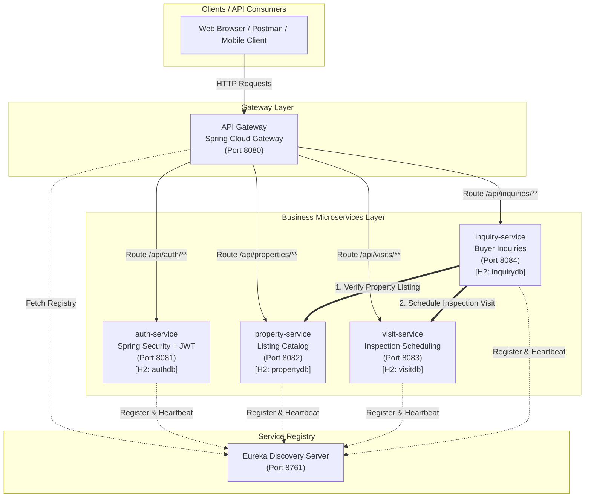
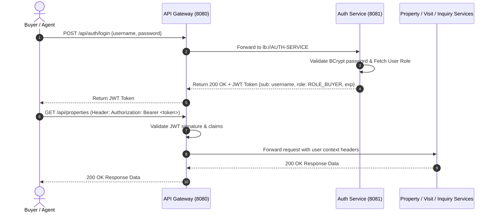
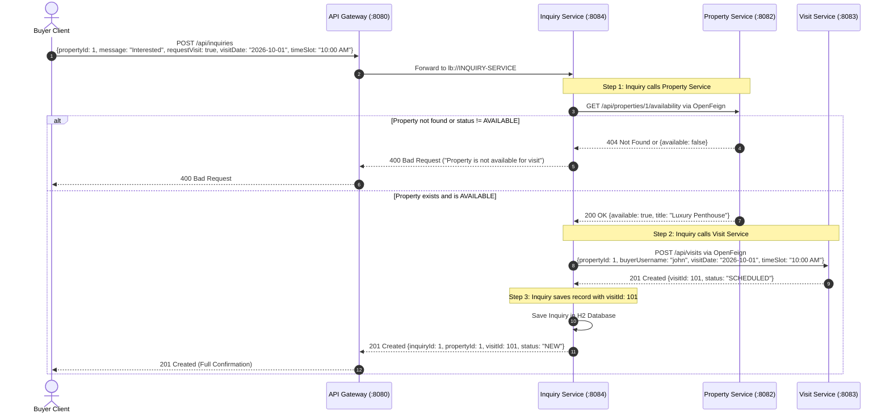

# Architecture & Design Document
## Enterprise Real Estate Listings & Property Inspection Scheduling Platform
**Platform Name:** PrimeHaven Real Estate Network  
**Target Delivery:** Academic College Review & Demo

---

## 1. Executive Summary & Beginner's Analogy

Building a microservices application can sound intimidating, but it follows everyday real-world organizational design. Think of PrimeHaven like a modern corporate real estate office:

- **The Reception Desk (`API Gateway` - Port 8080):** When a client walks into the building, they do not roam around looking for random offices. They talk to the receptionist at the front desk. The receptionist checks their security pass and directs them to the exact department they need.
- **The Internal Office Directory (`Eureka Server` - Port 8761):** Departments might move between rooms or expand. The office directory keeps an up-to-date phonebook of every department's current room number and status. The receptionist checks this directory before forwarding anyone.
- **Security & ID Card Badge Office (`Auth Service` - Port 8081):** Issues official digital badges (JWT tokens) after verifying a user's identity. Everyone shows this badge when entering restricted areas.
- **Listing & Property Catalog Department (`Property Service` - Port 8082):** Manages the catalogue of houses, villas, and commercial spaces available for sale or rent.
- **Site Visit & Inspection Scheduling (`Visit Service` - Port 8083):** Manages bookings for buyers who want to inspect a house in person.
- **Customer Inquiry Desk (`Inquiry Service` - Port 8084):** Handles buyer questions. If a buyer sends an inquiry saying *"I want to inspect this apartment this Saturday"*, the Inquiry Desk calls the Property Department to make sure the apartment is still available, and then calls the Visit Scheduling Department to book the inspection slot.

---

## 2. Technology Stack & Compatibility Verification

Before building the system, framework versions were verified against the official Spring compatibility matrix:

| Component | Selected Version | Compatibility Notes |
| :--- | :--- | :--- |
| **Java Runtime** | **Java 21 LTS** | Recommended LTS version for modern Spring applications. |
| **Spring Boot** | **3.3.4** | Production-ready, native support for Java 21, Spring Security 6. |
| **Spring Cloud** | **2023.0.3 (Leyton)** | Fully aligned with Spring Boot 3.3.x through Maven BOM. |
| **Build Tool** | **Maven 3.9+** | Multi-module / multi-service parent configuration. |
| **Security** | **Spring Security 6 + jjwt 0.12.6** | Stateless HMAC-SHA256 JWT validation. |
| **Inter-Service** | **Spring Cloud OpenFeign** | Declarative REST client with Eureka integration. |
| **Database** | **H2 In-Memory Database** | Zero external installation; instant setup for college demo. |

```xml
<!-- Maven BOM Import in Root Dependency Management -->
<dependencyManagement>
    <dependencies>
        <dependency>
            <groupId>org.springframework.cloud</groupId>
            <artifactId>spring-cloud-dependencies</artifactId>
            <version>2023.0.3</version>
            <type>pom</type>
            <scope>import</scope>
        </dependency>
    </dependencies>
</dependencyManagement>
```

---

## 3. High-Level System Architecture Diagram



---

## 4. Microservice Responsibilities & Port Allocations

| Service Name | Port | Primary Responsibilities |
| :--- | :---: | :--- |
| **`eureka-server`** | `8761` | Central service registry. Receives registration requests, maintains instance addresses, handles periodic heartbeats, and hosts the visual discovery web dashboard. |
| **`api-gateway`** | `8080` | Single entry point for all external client requests. Performs route matching, Eureka-based load balancing (`lb://<SERVICE-ID>`), and request header forwarding. |
| **`auth-service`** | `8081` | Manages user registration, credential hashing with BCrypt, authentication, and stateless JWT token issuance and validation. |
| **`property-service`** | `8082` | Manages real estate property listings (CRUD), property statuses, pricing, and exposes property availability verification APIs. |
| **`visit-service`** | `8083` | Handles property inspection appointments, visit date/time scheduling, and inspection status updates. |
| **`inquiry-service`** | `8084` | Receives buyer questions/leads and coordinates the composite `Inquiry -> Property -> Visit` workflow via OpenFeign. |

---

## 5. API Endpoint Specifications

All endpoints are accessible through the API Gateway at `http://localhost:8080`.

### 5.1 Auth Service (`/api/auth/**`)
| Method | Endpoint | Access | Description |
| :--- | :--- | :--- | :--- |
| `POST` | `/api/auth/register` | Public | Register new user (`username`, `password`, `email`, `role`). |
| `POST` | `/api/auth/login` | Public | Authenticate user; returns JWT token and user details. |
| `GET` | `/api/auth/validate` | Authenticated | Validates JWT token from `Authorization` header. |

### 5.2 Property Service (`/api/properties/**`)
| Method | Endpoint | Access | Description |
| :--- | :--- | :--- | :--- |
| `GET` | `/api/properties` | Public / Auth | List all properties (supports optional filters: `city`, `status`, `maxPrice`). |
| `GET` | `/api/properties/{id}` | Public / Auth | Get property details by ID. |
| `POST` | `/api/properties` | Agent / Admin | Create a new property listing. |
| `PUT` | `/api/properties/{id}` | Agent / Admin | Update existing property listing. |
| `DELETE` | `/api/properties/{id}` | Agent / Admin | Delete a property listing. |
| `GET` | `/api/properties/{id}/availability` | Internal / Auth | Check if property exists and has `AVAILABLE` status. |

### 5.3 Visit Service (`/api/visits/**`)
| Method | Endpoint | Access | Description |
| :--- | :--- | :--- | :--- |
| `POST` | `/api/visits` | Buyer / Auth | Schedule an inspection visit (`propertyId`, `buyerUsername`, `visitDate`, `timeSlot`, `notes`). |
| `GET` | `/api/visits` | Auth | Get visits (filterable by `buyerUsername` or `propertyId`). |
| `GET` | `/api/visits/{id}` | Auth | Get specific inspection visit details. |
| `PATCH` | `/api/visits/{id}/status` | Agent / Admin | Update visit status (`SCHEDULED`, `CONFIRMED`, `COMPLETED`, `CANCELLED`). |

### 5.4 Inquiry Service (`/api/inquiries/**`)
| Method | Endpoint | Access | Description |
| :--- | :--- | :--- | :--- |
| `POST` | `/api/inquiries` | Buyer / Auth | Submit inquiry. If `requestVisit=true`, triggers `Inquiry -> Property -> Visit` chain. |
| `GET` | `/api/inquiries` | Auth | Retrieve inquiries (filterable by `buyerUsername` or `propertyId`). |
| `GET` | `/api/inquiries/{id}` | Auth | Retrieve inquiry details. |
| `PATCH` | `/api/inquiries/{id}/status` | Agent / Admin | Update inquiry status (`NEW`, `IN_REVIEW`, `RESOLVED`). |

---

## 6. Database Plan (Database-per-Service Pattern)

To ensure loose coupling, no microservice directly accesses another microservice's database. Each service operates its own independent H2 in-memory database:

```
+------------------+     +----------------------+     +------------------+     +--------------------+
|   auth-service   |     |   property-service   |     |  visit-service   |     |  inquiry-service   |
+------------------+     +----------------------+     +------------------+     +--------------------+
         |                          |                          |                          |
         v                          v                          v                          v
  [ jdbc:h2:mem: ]           [ jdbc:h2:mem: ]           [ jdbc:h2:mem: ]           [ jdbc:h2:mem: ]
  [    authdb    ]           [   propertydb   ]           [   visitdb    ]           [   inquirydb    ]
```

### Entity Schemas

#### 1. `auth-service` -> `users` table
- `id` (BIGINT, Primary Key, Auto-increment)
- `username` (VARCHAR 50, Unique, Not Null)
- `email` (VARCHAR 100, Unique, Not Null)
- `password` (VARCHAR 255, Not Null, BCrypt Encrypted)
- `role` (VARCHAR 20, Not Null: `ROLE_BUYER`, `ROLE_AGENT`, `ROLE_ADMIN`)

#### 2. `property-service` -> `properties` table
- `id` (BIGINT, Primary Key, Auto-increment)
- `title` (VARCHAR 150, Not Null)
- `description` (TEXT)
- `address` (VARCHAR 255, Not Null)
- `city` (VARCHAR 100, Not Null)
- `price` (DECIMAL(12, 2), Not Null)
- `property_type` (VARCHAR 30: `APARTMENT`, `VILLA`, `COMMERCIAL`, `PENTHOUSE`)
- `status` (VARCHAR 20: `AVAILABLE`, `PENDING`, `SOLD`)
- `bedrooms` (INTEGER)
- `bathrooms` (INTEGER)
- `agent_username` (VARCHAR 50, Not Null)

#### 3. `visit-service` -> `visits` table
- `id` (BIGINT, Primary Key, Auto-increment)
- `property_id` (BIGINT, Not Null)
- `buyer_username` (VARCHAR 50, Not Null)
- `visit_date` (DATE, Not Null)
- `time_slot` (VARCHAR 20, Not Null, e.g. `10:00 AM - 11:00 AM`)
- `status` (VARCHAR 20: `SCHEDULED`, `CONFIRMED`, `COMPLETED`, `CANCELLED`)
- `notes` (TEXT)
- `created_at` (TIMESTAMP)

#### 4. `inquiry-service` -> `inquiries` table
- `id` (BIGINT, Primary Key, Auto-increment)
- `property_id` (BIGINT, Not Null)
- `buyer_username` (VARCHAR 50, Not Null)
- `inquiry_type` (VARCHAR 30: `PRICE_INQUIRY`, `VISIT_REQUEST`, `GENERAL`)
- `message` (TEXT, Not Null)
- `status` (VARCHAR 20: `NEW`, `IN_REVIEW`, `RESOLVED`)
- `visit_id` (BIGINT, Nullable — populated when visit is auto-scheduled)
- `created_at` (TIMESTAMP)

---

## 7. Security & JWT Authentication Flow

The platform utilizes **stateless JWT tokens**. Users exchange their credentials once at login, receive a signed token, and present that token in the `Authorization: Bearer <token>` header for subsequent requests.



### Key Token Properties:
- **Algorithm:** HMAC-SHA256 (`HS256`)
- **Payload Claims:**
  - `sub`: Username (e.g. `buyer_john`)
  - `role`: User authority (e.g. `ROLE_BUYER`)
  - `iat`: Issue timestamp
  - `exp`: Expiration timestamp (e.g. 24 hours)

---

## 8. Service Discovery & Gateway Routing

### 8.1 Eureka Registration Flow
When any microservice starts up, its Eureka client automatically sends a `POST` request to `http://localhost:8761/eureka/apps/{SERVICE-NAME}` registering:
- Service Name (e.g. `PROPERTY-SERVICE`)
- Hostname and Port (`localhost:8082`)
- Health check URL (`/actuator/health`)

Every 30 seconds, instances send a heartbeat `PUT` to renew their registration lease.

### 8.2 API Gateway Dynamic Routing Configuration
Spring Cloud Gateway routes requests based on URL path predicates and dispatches to registered services with client-side load balancing (`lb://`):

```yaml
spring:
  cloud:
    gateway:
      routes:
        - id: auth-service-route
          uri: lb://AUTH-SERVICE
          predicates:
            - Path=/api/auth/**

        - id: property-service-route
          uri: lb://PROPERTY-SERVICE
          predicates:
            - Path=/api/properties/**

        - id: visit-service-route
          uri: lb://VISIT-SERVICE
          predicates:
            - Path=/api/visits/**

        - id: inquiry-service-route
          uri: lb://INQUIRY-SERVICE
          predicates:
            - Path=/api/inquiries/**
```

---

## 9. Inter-Service Communication Flow (`Inquiry -> Property -> Visit`)

One of the standout requirements of the platform is the composite workflow:
**`Buyer Inquiry` $\rightarrow$ `Property Verification` $\rightarrow$ `Inspection Visit Scheduling`**



### Why this design excels for the college review:
1. **Demonstrates Distributed Orchestration:** Shows examiners that services are not siloed islands; they cooperate seamlessly over HTTP/REST using declarative Spring Cloud OpenFeign interfaces.
2. **Defensive Validation:** Prevents invalid visit bookings by ensuring property availability before committing inspection records.
3. **Traceability:** Links the resulting `visitId` directly inside the `Inquiry` record for end-to-end tracking.
